 

 

### `> about.md`

I'm a **Senior Frontend Engineer** with **10+ years** building fast, accessible, user-focused web apps, and a background in **Industrial Design** that shapes how I think about interfaces.

- 🏟️ At **Globant**, I build features for high-traffic products like **NFL.com**, **VIX / Univision** and **Red Sea Global**, working daily in English with US-based teams.
- ⚡ I care about **Core Web Vitals**, **accessibility (WCAG)** and scalable **component architecture**.
- 🤖 I'm **AI-native**: I build with Claude Code, Cursor and Cline, and I ship AI products. I built [**DivZone AI**](https://div.zone) solo, end to end.
- 🏆 Award-winning hackathon participant (2013–2016).

 

 

### `> featured_work/`

<table>
  <tr>
    <td width="50%"></td>
    <td width="50%"></td>
  </tr>
  <tr>
    <td width="50%"></td>
    <td width="50%"></td>
  </tr>
</table>

 

### `> stack/`

  <b>Frontend</b>  
  

  <b>Backend &amp; Data</b>  
  

  <b>Testing, DevOps &amp; Design</b>  
  

  <b>AI workflow</b>  
  
  
  
  
  
  

 

### `> contact`

Let's build fast, beautiful and accessible products together. Feel free to reach out on [LinkedIn](https://www.linkedin.com/in/gabriel-maza/) or by [email](mailto:gabrielmaza88@gmail.com). 🇦🇷 Based in Tucumán, Argentina · Spanish (native) · English (C1)

